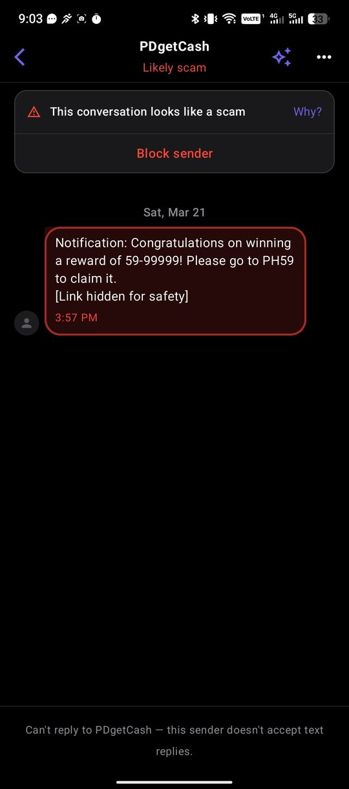
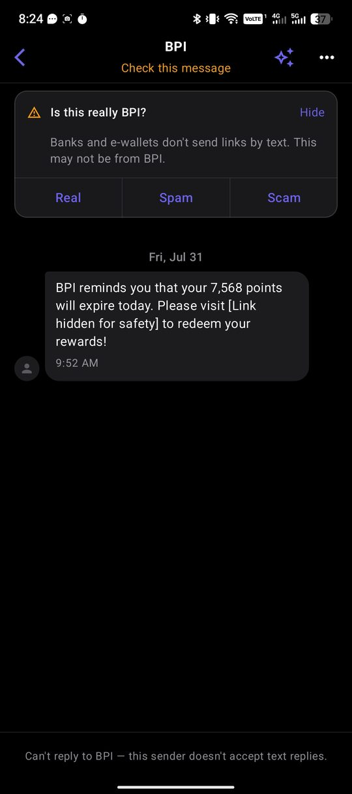
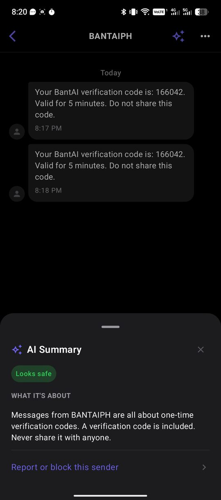
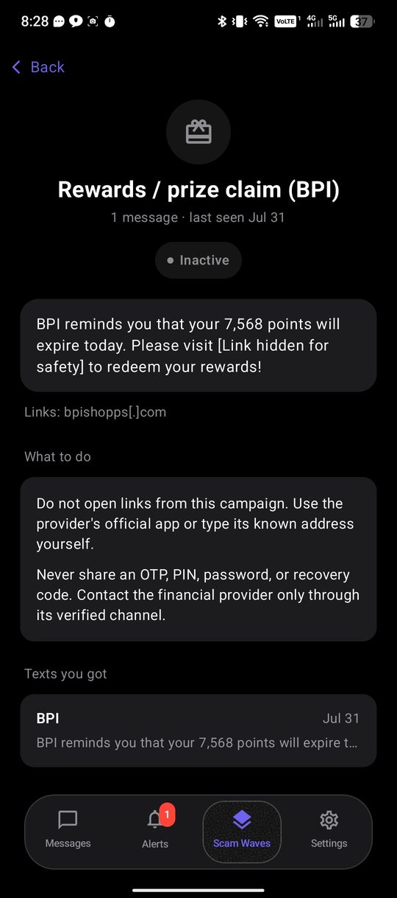
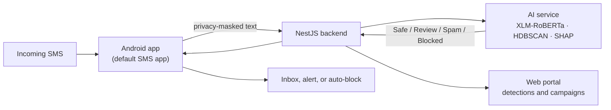

# BantAI — SMS Threat Intelligence

**AI smishing and scam detection for Filipino mobile users.** BantAI acts as the phone's SMS app, classifies each incoming message with a fine-tuned XLM-RoBERTa model, and warns about or blocks scams before the user opens them.

**[Web portal](https://bantai-student-web.calmsand-1a6d5c6b.eastasia.azurecontainerapps.io/)** · **[Android test build (signed APK)](https://github.com/gncrlatienza-eng/bantAI/releases)** · BS Computer Science thesis, De La Salle Lipa

| Detect | Warn | Explain | Group |
|:---:|:---:|:---:|:---:|
|  |  |  |  |
| A scam is flagged before you open it, with one tap to block the sender. | Messages that might be fake get a plain-language reason, and you decide: Real, Spam or Scam. | The AI Summary explains in plain words what a sender's messages are about, and whether they look safe. | Related scams are grouped into Scam Waves, with advice on what to do. |

## How it works

If the AI service can't be reached, the app falls back to an on-device check, so the user is still protected without a connection.

## Overview

BantAI is a thesis project that detects SMS smishing (SMS phishing) and scam
messages targeting Filipino mobile users. It intercepts incoming SMS on
Android, classifies each message using a fine-tuned XLM-RoBERTa model (with
an on-device keyword fallback when the classifier is unreachable), and
surfaces the result as an inbox message, a smishing alert, or an auto-block
— with SHAP-based explainability and campaign-level clustering to group
related scam waves.

- **Mobile app** (Kotlin + Jetpack Compose) — stands in as the user's default
  SMS app so messages are classified before the user ever sees them; includes
  live alerts, campaign tracking, and full message management.
- **Backend** (NestJS + Prisma + PostgreSQL) — phone OTP sign-in for the app
  (no passwords) and password/email sign-in for the web portal; ingests
  messages, orchestrates classification, and serves
  alerts/campaigns/verification data to the app.
- **AI service** (Python/FastAPI) — the classifier itself: privacy-masked
  preprocessing, a fine-tuned XLM-RoBERTa model routing messages to
  Safe/Review/Spam/Blocked, HDBSCAN campaign clustering, and SHAP
  explainability.
- **Web dashboard** (React + Vite) — admin/client portal for monitoring
  detections, wired to the backend.

The student deployment (backend, AI service and web) runs on Azure Container
Apps, and signed test APKs are published as GitHub pre-releases
(`student-android-v*`). See `docs/deployment/`.

See the per-folder READMEs and `docs/` for details on each piece.

## Project Structure

| Folder | Description |
|---|---|
| `mobile/` | Android app (Kotlin + Jetpack Compose) |
| `web/` | Web dashboard (React + Vite) |
| `backend/` | API server (NestJS + Prisma + PostgreSQL) |
| `ai/` | ML models, datasets, notebooks, scripts |
| `docs/` | Project documentation ([dev log](docs/development/DEV_LOG.md), [agile process](docs/development/AGILE_PROCESS.md), API reference: [auth](docs/api/auth.md), [users](docs/api/users.md)) |

## Tech Stack

- **Mobile:** Kotlin, Jetpack Compose, DataStore
- **ML:** XLM-RoBERTa, HDBSCAN, SHAP
- **Backend:** NestJS, Prisma, PostgreSQL, JWT (phone OTP for the app, email and password for the web portal)
- **AI service:** Python, FastAPI
- **Dashboard:** React, Vite, React Router
- **Deployment:** Azure Container Apps (backend, AI service and web); Android test builds published as GitHub pre-releases

## Code Quality & Security

Every stack has its own linter, formatter, and dependency-vulnerability scan. Full detail is in
each folder's README; quick reference:

| Folder | Lint / format | Security |
|---|---|---|
| `backend/` | `npm run lint`, `npm run format` (ESLint + Prettier) | `npm audit` |
| `web/` | `npm run lint`, `npm run format` (ESLint + Prettier) | `npm audit` |
| `ai/` | `ruff check .`, `ruff format .` | `pip-audit -r requirements.txt` |
| `mobile/` | `./gradlew.bat :app:ktlintFormat`, `:app:detekt` | no dependency scan yet — see `mobile/README.md` |

Each stack started with a deliberately narrow rule set against the existing codebase (get CI
green first, tighten incrementally) rather than a strict set applied all at once — see the
per-folder README or the relevant lint config's comments for what's deferred and why.

CI (`.github/workflows/ci.yml`) runs these checks plus each module's tests on every push and pull request to `develop` and `main`. The mobile job runs ktlint, detekt, a Kotlin compile and the unit tests.

## Branching Strategy

- `main` — stable production
- `develop` — integration branch
- `feature/<track>-<short-name>` — new features, e.g. `feature/mobile-blocked-numbers-sync`
- `bugfix/<track>-<short-name>` — bug fixes

Branch from `develop`, PR back into `develop`, delete after merge — keep branches
short-lived and scoped to one task rather than accumulating commits over weeks. See
`CLAUDE.md` for the full reasoning.

## Team

Built by Group 7 — DLSL CITE (BS Computer Science thesis project, De La Salle Lipa)

| Member | Role |
|---|---|
| Gio | Mobile |
| Maxene | AI/ML |
| Reymark De Castro | Backend |
| Daryl De Castro | Web |
